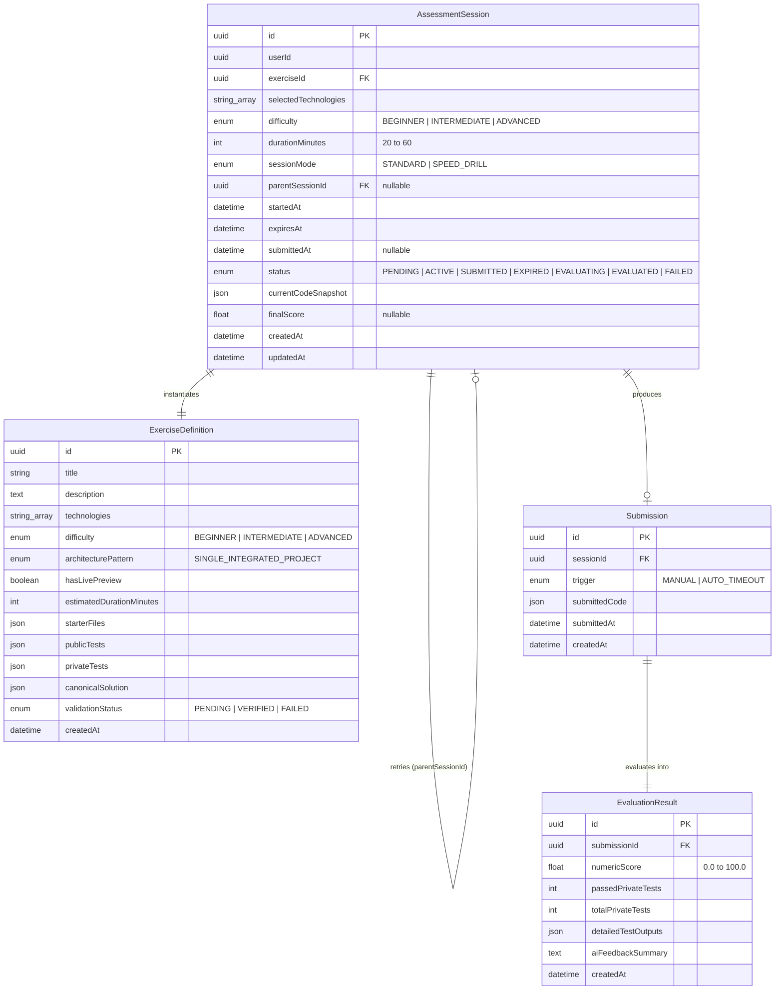
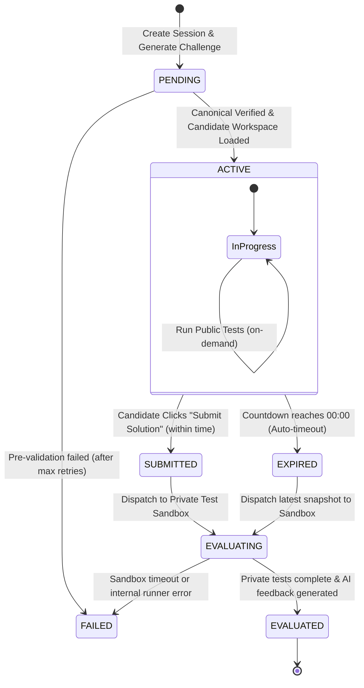

# Data Model: AI-Powered Technical Assessment Platform

**Feature**: `specs/001-ai-assessment-platform`
**Date**: 2026-10-01
**Status**: Completed

This document defines the domain entities, relational models, validation schemas, and lifecycle state machines for the assessment platform, strictly adhering to the Constitution's Type Safety and Clean Architecture principles.

---

## 1. Entity Relational Diagram

---

## 2. Entity Definitions & Attributes

### 2.1 `AssessmentSession`
Represents an individual timed practice or interview session.

| Field | Type | Nullable | Description / Validation |
|-------|------|----------|--------------------------|
| `id` | UUID | No | Primary Key. Generated using UUIDv4. |
| `userId` | UUID | No | Identifier of the practicing developer. |
| `exerciseId` | UUID | No | Reference to the assigned `ExerciseDefinition`. |
| `selectedTechnologies` | `string[]` | No | Target technologies (subset of `[HTML, CSS, JavaScript, TypeScript, React, NodeJS]`). |
| `difficulty` | Enum | No | `BEGINNER`, `INTERMEDIATE`, or `ADVANCED`. |
| `durationMinutes` | Integer | No | Enforced time budget, bounded strictly between `20` and `60`. |
| `sessionMode` | Enum | No | `STANDARD` (new exercise) or `SPEED_DRILL` (retrying previous exercise). |
| `parentSessionId` | UUID | Yes | Self-reference pointing to the previous session when running a `SPEED_DRILL`. |
| `startedAt` | DateTime (UTC)| No | Timestamp when the user confirmed and the timer began. |
| `expiresAt` | DateTime (UTC)| No | Authoritative deadline (`startedAt + durationMinutes * 60s`). |
| `submittedAt` | DateTime (UTC)| Yes | Exact moment the solution was submitted. |
| `status` | Enum | No | Session lifecycle state (see State Transitions). |
| `currentCodeSnapshot`| JSON | No | Map of file paths to current code string contents (`Record<string, string>`). Updated on auto-save every 30s. |
| `finalScore` | Float | Yes | Final percentage score (`0.0` to `100.0`). Set upon evaluation completion. |

### 2.2 `ExerciseDefinition`
Represents the self-contained coding challenge dynamically generated by Gemini.

| Field | Type | Nullable | Description / Validation |
|-------|------|----------|--------------------------|
| `id` | UUID | No | Primary Key. |
| `title` | String | No | Succinct challenge title (e.g., "Build a Real-Time Filterable Task Dashboard"). |
| `description` | Text | No | Markdown problem statement, constraints, and instructions. |
| `technologies` | `string[]` | No | Exact list of technologies required (guaranteed to match user selection). |
| `difficulty` | Enum | No | `BEGINNER`, `INTERMEDIATE`, or `ADVANCED`. |
| `architecturePattern`| Enum | No | Default `SINGLE_INTEGRATED_PROJECT`. |
| `hasLivePreview` | Boolean | No | `true` if `HTML`, `CSS`, or `React` is in `technologies`, triggering live UI preview panel. |
| `estimatedDurationMinutes`| Integer | No | Recommended time between `20` and `60`. |
| `starterFiles` | JSON | No | `Array<{ path: string, content: string, readOnly: boolean }>`. |
| `publicTests` | JSON | No | `Array<{ path: string, content: string }>`. Visible in candidate workspace. |
| `privateTests` | JSON | No | `Array<{ path: string, content: string }>`. Strictly withheld until evaluation. |
| `canonicalSolution` | JSON | No | `Array<{ path: string, content: string }>`. Reference solution used for pre-validation. |
| `validationStatus` | Enum | No | `PENDING`, `VERIFIED`, or `FAILED`. Pre-validation gate before presenting to candidate. |

### 2.3 `Submission`
Represents the final code snapshot submitted for private test evaluation.

| Field | Type | Nullable | Description / Validation |
|-------|------|----------|--------------------------|
| `id` | UUID | No | Primary Key. |
| `sessionId` | UUID | No | Reference to parent `AssessmentSession`. |
| `trigger` | Enum | No | `MANUAL` (clicked Submit) or `AUTO_TIMEOUT` (triggered by server/client clock expiry). |
| `submittedCode` | JSON | No | Manifest of all candidate-modified code files. |
| `submittedAt` | DateTime (UTC)| No | Authoritative submission timestamp. |

### 2.4 `EvaluationResult`
Represents the objective evaluation outcome and AI pedagogical review.

| Field | Type | Nullable | Description / Validation |
|-------|------|----------|--------------------------|
| `id` | UUID | No | Primary Key. |
| `submissionId` | UUID | No | Unique 1-to-1 reference to `Submission`. |
| `numericScore` | Float | No | Calculated percentage `(passedPrivateTests / totalPrivateTests) * 100`. |
| `passedPrivateTests` | Integer | No | Count of passing private test cases. |
| `totalPrivateTests` | Integer | No | Total count of private test assertions executed. |
| `detailedTestOutputs`| JSON | No | `Array<{ testName: string, status: "PASSED" | "FAILED", errorMessage?: string, diff?: string, durationMs: number }>`. |
| `aiFeedbackSummary` | Text | No | Pedagogical review highlighting code efficiency, edge cases missed, and speed tips. |

---

## 3. Session State Machine

### State Transition Invariants
1. **ACTIVE → SUBMITTED / EXPIRED**:
   - Transition to `SUBMITTED` is allowed ONLY when `currentTime <= expiresAt + 5s (grace period)`.
   - If `currentTime > expiresAt + 5s`, the session transitions automatically to `EXPIRED`.
   - Once in `SUBMITTED` or `EXPIRED`, all workspace mutation endpoints return `HTTP 403 Forbidden` / `HTTP 409 Conflict`.
2. **EVALUATED**:
   - `EvaluationResult` is permanently linked.
   - The candidate may trigger a `POST /api/assessments/:id/speed-drill` which creates a NEW session pointing to the same `exerciseId` with `sessionMode: SPEED_DRILL` and `parentSessionId: <currentSessionId>`.
